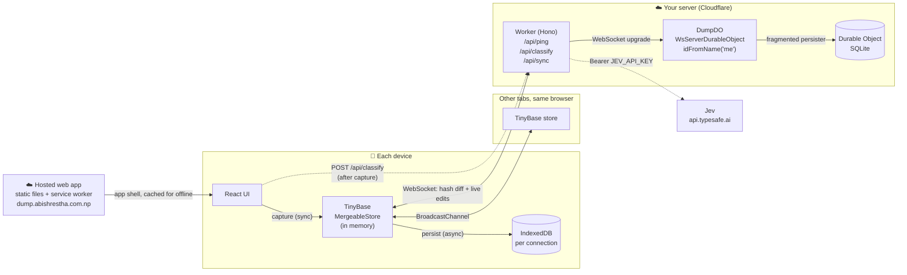
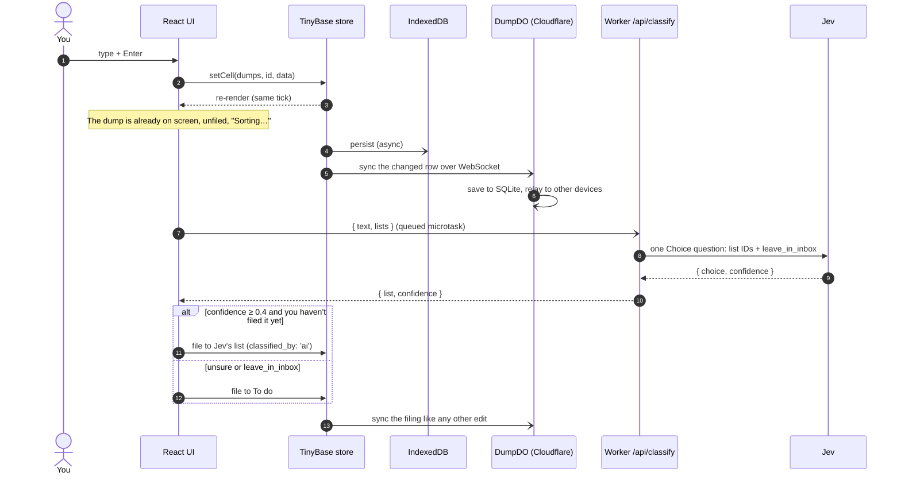
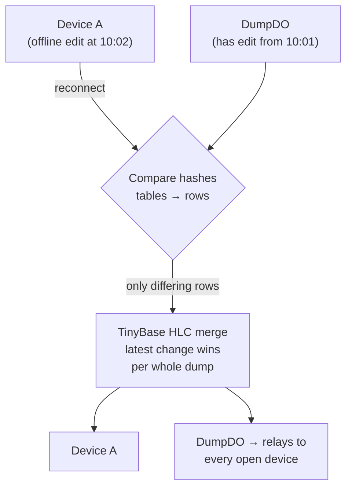

# Architecture

How Dump fits together and why it is built this way: the runtime picture, the code's layers and the seams between them, the words the code uses, the code map, and the decisions behind it. Day-to-day rules for each area are in the docs that [AGENTS.md](../AGENTS.md) maps.

## The big picture



There are three layers, and each one can fail without taking the ones before it down:

1. **Memory.** The capture handler writes to the TinyBase store and the UI updates in the same tick. It never waits on disk or the network.
2. **Device.** IndexedDB saves the store asynchronously, so a reload keeps your data even when offline. A failed save shows an error; it is never hidden.
3. **Cloud.** A WebSocket connects the device to one Durable Object. It carries changes both ways and saves them to SQLite.

## What happens when you press Enter



If the request fails or you close the tab mid-request, the dump simply stays unfiled. **Unfiled open dumps are the retry queue.** They are sent again on the next load or reconnect, at most three at a time.

## Sync and conflicts



- **Each dump is one atomic JSON cell.** A dump's list, done flag, and provenance merge together, so a conflict picks one whole version and never mixes fields from two edits.
- **TinyBase's hybrid logical clocks decide who wins.** `updated_at` is display metadata only and never competes with the merge clock.
- **Nothing is physically deleted.** Removal sets `deleted: true`, a tombstone that syncs like any edit. Without it, an older copy would bring the dump back.
- **The server doesn't read rows.** It stores and relays them. Every client decodes rows with Zod in `readRows` (`src/shared/merge.ts`) and skips any that fail.

## Code layers and seams

The code is a stack, and each layer imports only the layers below it ([CODING_STANDARDS.md § Layers](../CODING_STANDARDS.md#layers) has the rules, and lint enforces the imports). Put a behavior in the lowest layer that can own it, and every client gets it.

| Layer | Paths | What it owns |
| --- | --- | --- |
| Contracts | `src/shared/` | Row formats, the API's request and response schemas, the merge store, due days. |
| Core | `src/core/` | Everything a notebook does: commands, the filing queue, the sync lifecycle, views, profiles and sessions. It runs in browsers, JavaScriptCore, Hermes and Node. |
| Platforms | `src/client/browser-platform.ts` and `src/client/profiles.ts`; `mac/engine/platform.ts` and `mac/engine/settings.ts`, over `mac/Sources/DumpKit/`; `mobile/src/platform.ts` and `mobile/src/profiles.ts`; `cli/platform.ts` | Where a notebook is stored, device events, settings and owner keys, behind `ClientPlatform` and `Setting`. |
| Surfaces | `src/client/` (React); `mac/engine/index.ts` and `mac/Sources/Dump/` (SwiftUI); `mobile/src/` screens (React Native); `cli/index.ts` and `cli/render.ts` (text) | Drawing the core's views and calling its commands, and nothing more. |

The server stands beside the stack: `src/server/` imports only the contracts and relays rows without reading them.

A seam is where a change in one place reaches code in another that the first place's compiler can't see. `npm run verify` runs the checks on both sides of every seam a change reaches; this table says what is on the far side, and where no check can look:

| Seam | Defined in | Far side | What catches a mismatch |
| --- | --- | --- | --- |
| Row format | `dumpSchema` and `collectionSchema` in `src/shared/schema.ts`, which are strict | Every reader, backups (`exportSchema`), and installed builds older than the change | `tests/domain.test.ts` for current builds; nothing for installed older ones ([core.md § Data model](core.md#data-model)). |
| HTTP contract | `src/shared/api.ts`, `src/shared/classify.ts` | `src/server/index.ts`; `src/core/connection.ts`, `server-link.ts` and `classify.ts`; servers already deployed | Unit tests and e2e. A server and the hosted client deploy separately, so deploy in the order [release.md § Deploy](release.md#deploy) gives. |
| Commands and views | what `createDumpClient` returns (`src/core/client.ts`), and `src/core/views.ts` | `src/client/`, `mobile/src/`, `cli/`, and the engine in `mac/engine/index.ts` | Each client's typecheck, and `tests/views.test.ts`. |
| Swift bridge | the `engine` object in `mac/engine/index.ts`, `Native` in `mac/engine/native.ts`, and the `host` callbacks | `mac/Sources/DumpKit/Engine.swift`, which names each of them in a string and decodes the engine's JSON into `Models.swift` | `tests/seams.test.ts` for the names; `swift test` for arguments and results. A renamed result field compiles on both sides and fails at run time; Swift ignores fields it doesn't decode, so adding one is safe. |
| Platform | `ClientPlatform` in `src/core/client.ts`, `Setting` in `src/core/setting.ts` | The four platform adapters, and the fake `platform()` in `tests/client.test.ts` | Each one's typecheck, the fake's included. |
| Web APIs | what `src/core` and `src/shared` call at run time | `mac/engine/polyfills.ts`, `mobile/src/runtime.ts` | Lint rejects browser-only globals; `swift test` runs the engine in JavaScriptCore; nothing runs Hermes, which is checked by hand ([mobile.md § Runtime](mobile.md#runtime)). |

To see a layer run rather than read it:

| Layer | Drive it with | Details |
| --- | --- | --- |
| Core, sync, Jev's filing | `node cli/dump.mjs` devices against `npm run scratch` | [testing.md § The dump CLI](testing.md#the-dump-cli) |
| Server | `npm run scratch`, its log, and `curl` with an allowed `Origin` | [server.md § Local servers](server.md#local-servers) |
| Web app | the preview of `npm run dev` on 6191 | [web-client.md](web-client.md) |
| Mac app | `dump-check`, the app's log, offscreen renders | [mac.md § Build and check](mac.md#build-and-check) |
| Phone app | the iOS simulator | [mobile.md § Build and check](mobile.md#build-and-check) |

## Words

The code's names differ from the product's in a few places. Grep for the code name.

| Word | Meaning | In code |
| --- | --- | --- |
| dump | One captured thought or link. | `Dump`, the `dumps` table |
| list | A place dumps are filed in, such as To do or Buy. | `Collection` (never `List`), the `lists` table |
| `!list` prefix | A list named at the start of a dump, which files it at capture. | `listPrefix`, `prefixFor` |
| inbox, unfiled | Open dumps with no list. Sort inbox walks the ones Jev isn't sorting. | `list: null`; `Notebook.unfiled` |
| To do | The list Jev falls back to when it is unsure. | `DEFAULT_LIST` (`'todo'`) |
| filing | Putting a dump in a list, by the owner or by Jev. | `file`, `classified_by` |
| Jev, sorting | The model that files dumps, and a dump waiting on its answer. | `autoFile`, `/api/classify`, `Snapshot.sorting` |
| tombstone | A removed dump or list, kept so the removal syncs. | `deleted: true` |
| day | The calendar day a dump is for. | `due`, `parseDue` |
| home, Today | The one view of every open dump, ending in Today's sections. | `home`, `agenda` |
| place | A view: home, one list, or Done. | `Place` |
| notebook | One owner's dumps and lists, on a server or on one device. In `views.ts`, `Notebook` is one snapshot split into open, done and unfiled. | `Notebook` |
| profile | A notebook this device knows, and the server it syncs with. | `ServerProfile`, `profileRegistry`, stored as `dump-connections` |
| server | One owner's Worker and Durable Object. Its `instanceId` names its notebook. | `ServerLocation`, `DumpDO` |
| owner key, ticket | The server's one secret, and the short-lived proof of it that opens a WebSocket. | `OWNER_KEY`, `/api/sync-ticket` |
| session | The notebook open on this device, and connecting, switching and signing in. | `createSession` |
| platform | What a device supplies to the core. | `ClientPlatform` |
| snapshot | The core's state, which surfaces draw. The Mac engine's `snapshot(full)` is a different shape: views already grouped and labelled, decoded by `Models.swift`. | `Snapshot` |
| engine | The core bundled for the Mac's JavaScriptCore, and the API Swift calls. | `mac/engine/`, `Engine.swift` |
| web app origin | The `Origin` a native app presents to a server. | `originSetting` |

## Code map

```
src/
├── shared/            imported by both client and Worker
│   ├── schema.ts      Zod codecs for dumps, lists, backups; TinyBase table schema
│   ├── due.ts         due days: read from a dump's text; how home groups dumps (agenda)
│   ├── merge.ts       store factory, readRows (validated decode), sync tuning
│   ├── classify.ts    Jev request/response mapping, threshold
│   ├── api.ts         response schemas for /api/ping and /api/sync-ticket
│   └── hosts.ts       which hosts are local development (no imports)
├── core/              reusable client logic, no React/browser/Worker dependencies
│   ├── client.ts      notebook instance, commands, AI queue, start/stop lifecycle
│   ├── connection.ts  server URL validation, identity checks, storage names
│   ├── server-link.ts one server over fetch + WebSocket (every client)
│   ├── classify.ts    stateless classification HTTP client
│   ├── views.ts       what every client shows: places, Today, labels, search, attention
│   ├── profiles.ts    notebook registry over a platform setting; the connect rule
│   ├── session.ts     the open notebook: connect, switch, sign in
│   ├── setting.ts     the Setting type a platform keeps values with (no imports)
│   ├── origin.ts      the web app origin native apps present to servers
│   └── device.ts      device events hub for native apps
├── client/            React app
│   ├── main.tsx       entry: picks notebook or landing page, lazy-loads it
│   ├── store.ts       the core's session (switching reloads), React subscription, export
│   ├── browser-platform.ts  IndexedDB, WebSocket, tab sync, device events
│   ├── profiles.ts    the notebook registry and owner keys in localStorage
│   ├── registry.ts    has this browser a notebook? decides what / shows
│   ├── boot.ts        holds the loading screen until the notebook is ready
│   ├── App.tsx        notebook shell: top bar, views, composer
│   ├── Marketing.tsx  lazy landing page with onboarding
│   ├── styles.css     cascade layers, Astryx + Tailwind bridge, base rules
│   ├── lib/           viewport.ts (phone keyboard), colorMode.ts (Light/Dark/System), toast.tsx, utils.ts
│   └── components/    Astryx-built cards, due dates, search, dialogs, settings, onboarding; Brand, ListDot, RouterLink
├── themes/dump/       local Astryx theme: dumpTheme.ts source, dump.fonts.css, built dump.js/.css
├── astryx-themes.ts   generated by `npx astryx theme`: the app's themes and default slug
└── server/            Cloudflare Worker, API only
    ├── index.ts       Hono routes, origin checks, owner-key checks, security headers, Jev proxy
    ├── auth.ts        owner key comparison and WebSocket tickets
    ├── origins.ts     client origin allowlist
    ├── dump-do.ts     DumpDO (TinyBase WsServerDurableObject + SQLite persister)
    └── env.ts         Worker bindings
mac/                   menu bar app (Swift); see docs/mac.md
├── engine/            src/core + TinyBase bundled for JavaScriptCore, with web API polyfills and settings
├── Sources/DumpKit/   runs the engine: native timers, HTTP, WebSocket, files, user defaults, Keychain
├── Sources/Dump/      AppKit/SwiftUI shell: hotkey, capture panel, notebook window, settings, menu bar
├── Sources/dump-check/  headless sync check against a running server
├── Tests/             DumpKit tests: the engine in JavaScriptCore
├── Package.swift      SwiftPM targets: Dump, DumpKit, dump-check, tests
└── scripts/           build-app.sh (build, sign, --install) and the icon renderer
mobile/                iOS and Android app (Expo, React Native); its own npm package; see docs/mobile.md
├── index.ts           loads the runtime shims, then the app
├── app.json           Expo config: names, bundle IDs, icons, splash, plugins
├── metro.config.js    bundles ../src/core and ../src/shared with this app's packages
├── assets/            app icon, Android adaptive icon layers, splash
└── src/
    ├── runtime.ts     web APIs Hermes lacks, and the Origin header on server requests
    ├── settings.ts    a value in the key-value store (no imports the runtime needs)
    ├── origin.ts      the owner's choice of web app origin
    ├── platform.ts    ClientPlatform: SQLite, app state, network
    ├── profiles.ts    the notebook registry and owner keys (Keychain, Keystore)
    ├── notebook.ts    the core's session: launch, switch, connect, sign in
    ├── views.ts       rows for the inverted lists, from the core's views
    ├── App.tsx        native stack navigation
    ├── screens/       Notebook (home, a list or Done), Search, PickDay, ListEditor, SortInbox, Settings
    ├── DumpRow.tsx    a dump: done circle, swipe actions, context menu
    ├── Composer.tsx   capture field pinned above the keyboard
    ├── menu.tsx       native menus, with an action sheet in Expo Go
    ├── ui.tsx         icons, sections, buttons, header items
    └── theme.ts       light and dark colors from the web app
cli/                   the dump CLI: the core on Node, as a device driven from a shell
├── dump.mjs           bundles index.ts with the core (rolldown) and runs it
├── index.ts           arguments, the run's lifecycle, commands
├── platform.ts        ClientPlatform: a folder of TinyBase JSON files, settings, keys, Origin
└── render.ts          the core's views as text, one line per dump
scripts/
└── verify.mjs         runs the checks a change reaches
tests/                 Vitest unit, seam and docs tests + Playwright e2e
public/                _headers (CSP), theme-init.js, icons
docs/                  notes for coding agents, one per area (see AGENTS.md)
wrangler.jsonc         API server deploy config
wrangler.client.jsonc  web client deploy config (static assets only)
```

The client and Worker compile separately (`tsconfig.client.json`, `tsconfig.json`) and build separately: Vite builds only the client into `dist/client/`, and Wrangler bundles the Worker (`npm run build:server` dry-runs it into `dist/server/`). Browser code imports the shared API contract but never Worker implementation types.

## Why these decisions

| Decision | Why | Trade-off accepted |
| --- | --- | --- |
| **Local-first, synchronous capture** | Capture is the whole product. A thought typed in a tunnel or on bad Wi-Fi must appear right away and survive a reload. | Each device has its own copy, so "saved here" and "synced" are shown as separate states. |
| **TinyBase MergeableStore** | CRDT-style merging with hybrid logical clocks is built in, along with IndexedDB and Durable Object persisters and a WebSocket synchronizer. Nothing had to be built by hand. | It merges whole records, not text. Two edits to the same dump pick one winner and never merge character by character. |
| **Built-in WebSocket sync, not a custom protocol** | Peers compare hashes and send only the rows that differ, and live edits reach every open device. An earlier version sent HTTP snapshots and polled; each poll sent the whole store and eventually hit a size limit. | WebSockets are required. There is no HTTP fallback, so changes stay on the device until a working network is available. |
| **One Durable Object (`idFromName('me')`)** | There is one user and one dataset, so one DO is the natural fit. It has strongly consistent SQLite storage, hibernating WebSockets, and no separate database to run. | It doesn't scale to multiple users. That's intentional: no accounts, tenants, D1, Postgres, or KV. |
| **Atomic JSON cell per dump** | Filing and its provenance (`classified_by`) must always change together. | The whole dump is rewritten on every edit, which is fine at this scale. |
| **Tombstones, never `delRow`** | A deleted row would come back from any copy that still has it. | Tombstones accumulate. Compaction needs a deliberate design first. |
| **Latest change wins, including offline edits** | The owner uses one device at a time. Precedence rules and revision checks would add complexity with no real benefit here. | A stale offline device can overwrite a newer change to the same dump. |
| **No undo** | Done, filing, and remove are final. Earlier undo logic could restore unrelated fields and conflicted with sync. | Mistakes are fixed by hand. Removal has a confirm step where it matters (Clear done, delete list). |
| **Validate on read, not on the server** | The sync server relays rows it doesn't understand, which keeps it simple. Clients use Zod to reject malformed data. | A bad row is skipped rather than rejected at the source. |
| **One hosted app, a server per person** | The web app is static files that one host serves to everyone; each person's server is one Worker and DO. Either half redeploys alone, and the Mac and phone apps (and a future Raycast client) use the same API. `npm run dev` still starts both. Zod schemas in `src/shared` are the API contract both sides check. | Two deploys, and every client origin must be listed in `ALLOWED_CLIENT_ORIGINS`. The server is tied to Cloudflare's runtime. |
| **The Mac app runs the web core** | JavaScriptCore runs the same TypeScript client core, so sync, filing, and merge rules can't drift from the web app; Swift supplies only the platform (timers, HTTP, WebSocket, files, user defaults, Keychain) and draws what the engine sends. | A small set of web API polyfills to maintain, and the app must be rebuilt when the core changes. |
| **The phone app is React Native running the web core** | Hermes runs the same TypeScript core, so the phone follows the same sync and filing rules, while native navigation, menus, gestures and keyboard handling give it the feel that the PWA and a Capacitor wrapper lacked. | A fourth build (Expo, Metro, CocoaPods, Gradle) with its own dependencies and runtime shims, a second UI to keep in step with the web, and iOS installs need signing. |
| **Astryx for the web UI** | One design system supplies accessible components, theming and light/dark tokens, so the app's code holds layout and behavior rather than styling. The `dump` theme extends Matcha with Dump's lime and its own fonts (see [web-client.md § Design system](web-client.md#design-system)). | A large dependency whose components set some behavior (menus stay in the DOM, the palette sits near the top), a theme to rebuild after edits, and a CLI-managed block in `AGENTS.md`. |
| **One owner key, not accounts** | Each server belongs to one person, so a single generated secret covers every device with no sign-up, cookies, or session store. Tokens work across sites, where cookies would not. | Cutting off one lost device means rotating the key and entering the new one on the others. See [Security](../README.md#security). |

## Why Jev

[Jev](https://typesafe.ai/blog/introducing-system-one-models-and-jev) is TypeSafe's System One model. Instead of generating text, it answers **constrained questions** such as "which of these options?", and it returns a confidence score with each answer.

That fits Dump's main AI rule: **AI may file, never rewrite.**

| Need | Why Jev fits |
| --- | --- |
| Never change the user's words | Jev can't generate text. It can only choose from the keys we send (list IDs + `leave_in_inbox`). |
| Structured, parseable output | The answer is always one of our IDs plus a confidence. There is no prompt parsing and no JSON repair. |
| Know when it's unsure | The confidence score drives the fallback. Below `CLASSIFY_THRESHOLD` (0.4) the dump goes to To do. |
| Fast enough to feel instant | In live testing it answered in about 400 ms (948 ms cold), and it runs after capture, so it never blocks Enter. |
| Allow "none of these" | `leave_in_inbox` lets Jev decline instead of forcing a bad match. |

**Why a Worker proxy?** Jev's CORS policy rejects browser origins, and the API key must never ship in the bundle. `POST /api/classify` is stateless. It validates `{ text, lists }`, forwards one Choice question, checks the answer against the lists it sent (a list could be deleted during the request), and returns `{ list, confidence }`.

**Why is it optional?** Jev is on exactly when `JEV_API_KEY` is set. Without the key, or with fewer than two lists, dumps stay in the inbox for you to sort, and `/api/ping` reports `classify: false`. E2e servers never call Jev.

**Why does the threshold sit at 0.4?** In early tests, correct Buy/Decor picks came back at 0.60–0.65 confidence. Jev's top pick still beats the To do fallback when it's somewhat unsure. The threshold should be tuned against real labelled dumps.
